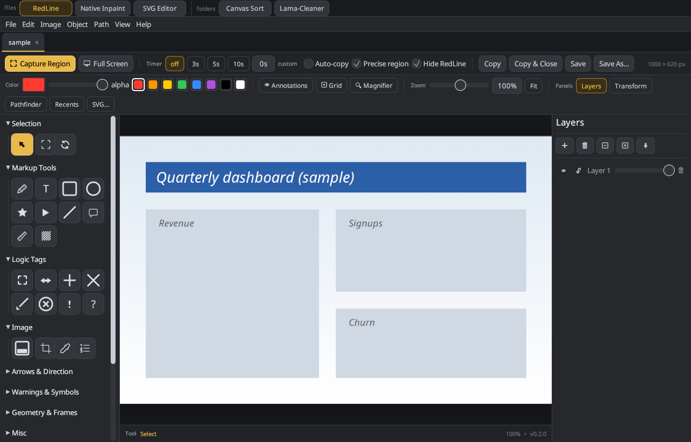

# Redline

A native, GPU-accelerated (Rust + [egui](https://github.com/emilk/egui)) tool for **annotating screenshots**, with a layered vector editor, local AI inpainting, and an optional local MCP server so AI agents can draw on your canvas.



## Features
- **Capture & annotate:** region / full-screen capture (Linux, via the XDG screenshot portal) with an in-app region selector, timers, and auto-copy; pen, text, shapes, arrows, callouts, blur/pixelate, stamps, logic tags.
- **Layered vector editor:** scene graph with layers, groups, path operations (union/subtract/…), affine transforms with an on-canvas gizmo and numeric panel, SVG export, raster-to-SVG vectorizing.
- **Native Inpaint** *(optional features)*: in-process LaMa object removal (ONNX Runtime) and prompt-driven generative fill (Stable Diffusion 1.5 / SDXL via [candle](https://github.com/huggingface/candle)). Results land as undoable image layers.
- **Canvas Sort:** a folder-based mode for arranging and sorting many images with notes.
- **Agent server (opt-in):** a localhost-only, token-authenticated [MCP](https://modelcontextprotocol.io) server so tools like Claude Code can read and draw on the canvas. See [docs/integration/claude-code.md](docs/integration/claude-code.md) and [SECURITY.md](SECURITY.md).
- **Local AI collaborator (optional):** talk to a local [Ollama](https://ollama.com) model that draws through the same tool surface.

## Platform support
| Platform | Status |
|---|---|
| Linux (X11 / Wayland) | Developed and tested here |
| macOS, Windows | Built and unit-tested in CI; screen capture relies on the Linux XDG portal and is not available there. Not manually tested. |

## Install
Download a binary from [Releases](../../releases) (Linux x86_64, macOS arm64, Windows x86_64), or build from source.

## Build from source
```sh
# Linux build dependencies
sudo apt-get install libxkbcommon-dev libwayland-dev libgl1-mesa-dev libx11-dev libxcursor-dev libxi-dev libxrandr-dev libssl-dev pkg-config

cargo build --release
./target/release/redline [FILE] [--capture region|full]
```
`./install.sh` (Linux) builds with the AI features and installs a desktop entry; see [RELEASING.md](RELEASING.md).

### Cargo features
| Feature | Default | What it adds |
|---|---|---|
| `agent-server` | yes | Opt-in MCP server (off at runtime until enabled in the AI / Agents menu) |
| `local-ai` | no | Ollama-backed collaborator |
| `native-inpaint` | no | LaMa removal. Needs ONNX Runtime **1.22.x** (`ORT_DYLIB_PATH=/path/to/libonnxruntime.so`); the ~208 MB model downloads on first use to `~/.local/share/redline/native-models/` and is SHA-256 verified. CPU fallback if CUDA is unavailable. |
| `native-generative` | no | Stable Diffusion inpainting via candle. **Requires the CUDA toolkit to build** and downloads weights from Hugging Face on first use. |
| `lama-webview` | no | Embedded GTK/WebKit view for the legacy Python `lama-cleaner` mode (Linux; pip-installs a pinned `lama-cleaner` into a private venv on first use) |
| `pdf` | no | PDF import via PDFium |

Debugging screen capture: `REDLINE_CAPTURE_DEBUG=1 redline`. General warnings: `REDLINE_LOG=1`.

## Privacy
No telemetry and no update checks. Network access happens only when you use a feature that needs it (model downloads from Hugging Face, an Ollama endpoint you configure, the optional lama-cleaner install). Details in [SECURITY.md](SECURITY.md).

## Licensing
Apache-2.0, see [LICENSE](LICENSE). Third-party crates: [THIRD_PARTY_LICENSES.md](THIRD_PARTY_LICENSES.md). Bundled assets and the licenses of the AI models you can download (some carry use restrictions): [docs/LICENSING.md](docs/LICENSING.md).
Substantial parts of this code were written with AI assistance under human review. Provided "as is", without warranty.

## Contributing
See [CONTRIBUTING.md](CONTRIBUTING.md) and the [Code of Conduct](CODE_OF_CONDUCT.md).
